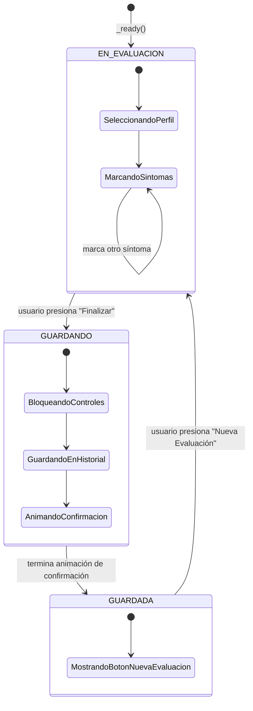

# Diagrama de Estados — Flujo de Evaluación (Laboratorio 6)

Componente: `src/scenes/simulation/step_1_base.gd`

## Tabla de transiciones

| Desde | Hacia | Evento / condición | ¿Permitida? |
|---|---|---|---|
| `EN_EVALUACION` | `GUARDANDO` | Usuario presiona "Finalizar y Guardar Evaluación" | ✅ |
| `GUARDANDO` | `GUARDADA` | Termina la animación Tween de confirmación | ✅ |
| `GUARDADA` | `EN_EVALUACION` | Usuario presiona "Iniciar Nueva Evaluación" | ✅ |
| `EN_EVALUACION` | `GUARDADA` | (saltarse el guardado) | ❌ |
| `GUARDANDO` | `EN_EVALUACION` | (cancelar a mitad de guardado) | ❌ |
| `GUARDADA` | `GUARDANDO` | (volver a guardar sin reiniciar) | ❌ |

`change_state()` es la única función que modifica `current_state`.
Mientras `current_state != EN_EVALUACION`, los botones de perfil y de
síntomas quedan deshabilitados (`boton.disabled = true`) — el estado
actual determina qué interacciones son válidas.
